# 360° spherical panorama stitching

I built a CPU-only Python and OpenCV pipeline that turns a handheld phone sweep into an equirectangular 360° panorama, plus a browser viewer to look around in it. Every geometric decision is a module you can read, not a single "stitch" call.

[](https://github.com/Kronbii/360-spherical-stitching/releases/latest)
[](requirements.txt)
[](requirements.txt)

**[Open the live viewer: 360.ramikronbi.com](https://360.ramikronbi.com)**

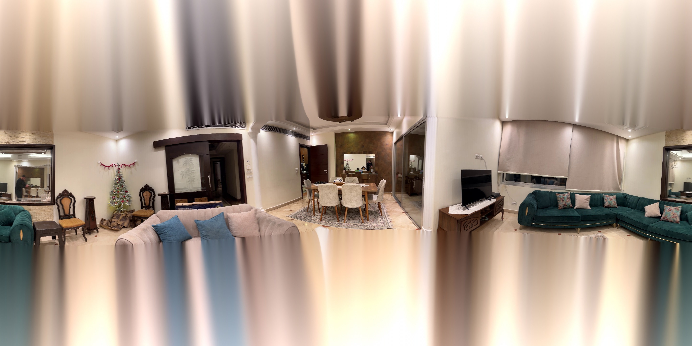

*309 frames of a phone video, one handheld sweep, 4096 × 2048 out, orientations from bundle adjustment.*

## Why

A panorama looks simple only after it works. Before that it is a chain of small geometric errors: a few bad matches tilt the camera estimate, a fraction of a degree of pitch turns a ceiling edge into a staircase, and a step sideways adds parallax that no homography can explain. General-purpose stitchers hide those decisions behind one call, which makes it hard to say why a panorama tilts, ghosts or drifts. I wanted each one out in the open. No tripod and no stitching app: the geometry comes from image features and a pure-rotation camera model. A gyroscope log helps if you have one, but isn't needed.

## One run

The 309-frame handheld sweep above, every second frame of a phone video, matched at full resolution, CPU only, with the defaults in [config.yaml](config.yaml):

| | |
|---|---|
| Frames in | 309 |
| Recovered sweep | 323.6° (the clip stops just short of its start) |
| Frame pairs matched and solved together | 1,305 |
| Median inliers per pair | 489 |
| Reprojection error | 1.9 px RMS on held-out matches (36.9 px with the v1 chain) |
| Sphere actually imaged | 33.2% |
| Output | 4096 × 2048, equirectangular |
| End-to-end time | ~3½ minutes (about 2 for orientation, 1 for warping) |
| Peak memory | 1.7 GB |

## How it works

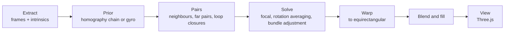

1. **Extract.** Frames come out of the video by interval, count, frame rate or measured motion, each with its presentation time ([video_utils.py](src/video_utils.py)). Focal length comes from a calibration file, EXIF, or a stated field of view ([intrinsics.py](src/intrinsics.py)).
2. **Prior.** A first guess at every frame's orientation. Without a gyro it is the v1 chain: ORB features between neighbouring frames, Lowe's ratio test, RANSAC, and `R = K⁻¹HK` projected back onto a rotation by SVD ([features.py](src/features.py), [rotation.py](src/rotation.py)). With a gyro log it is the gyro, integrated between frame timestamps; the clock offset and the gyro-to-camera axes are worked out from the video ([imu.py](src/imu.py)).

   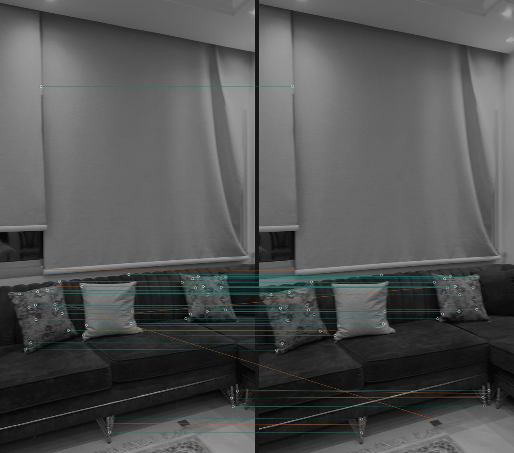

3. **Pairs.** Every frame is matched with its next three, with one frame about half a field of view away, and with the frames the sweep reaches again after going round: the loop closures a chain never sees. Matches are searched only near where the prior says each keypoint lands, and each pair is fitted with a rotation-only model ([guided_match.py](src/guided_match.py)).
4. **Solve.** First the focal length at which all pairs agree best; a wrong one scales every rotation and breaks the loop. Then rotation averaging makes every frame consistent with every pair at once, spreading the loop's accumulated error over the whole sweep. Last, bundle adjustment refines all rotations against the pixels ([orientation.py](src/orientation.py), [bundle_adjust.py](src/bundle_adjust.py)). No smoothing is needed, so real motion is kept.

   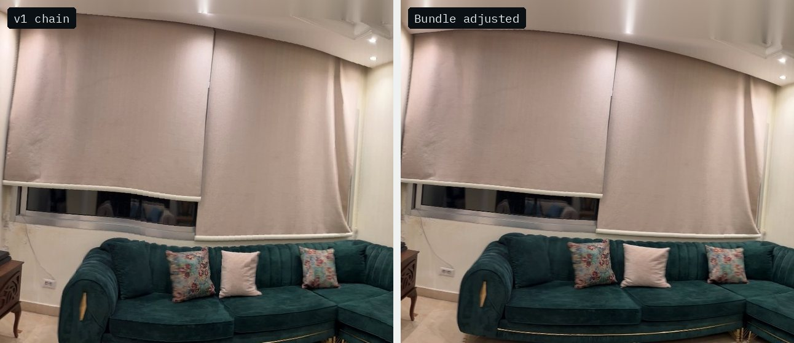

5. **Warp.** Each output pixel is a world direction; rotate it into the camera, project it onto the image plane, sample ([warp_sphere.py](src/warp_sphere.py)).

   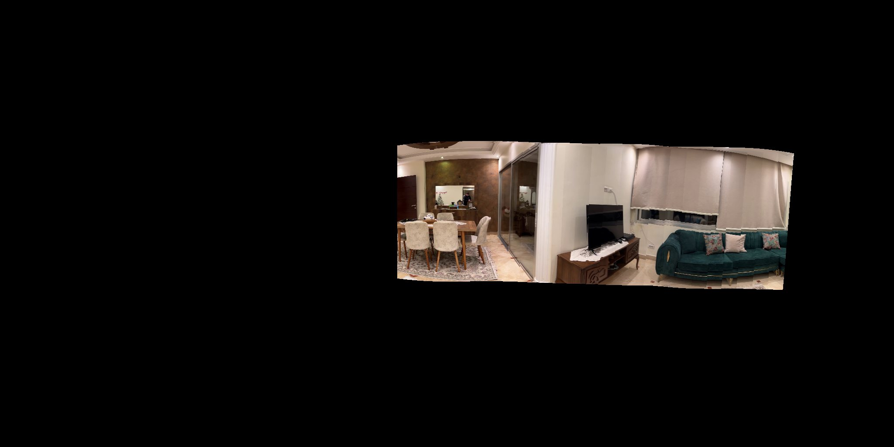

6. **Blend and fill.** Overlaps are blended (`multiband`, `feather`, `sharp` or `none`) and whatever the sweep never saw is inpainted from its surroundings ([blend.py](src/blend.py)). Filling is not reconstruction.
7. **View.** A self-contained Three.js page is written next to the panorama.

   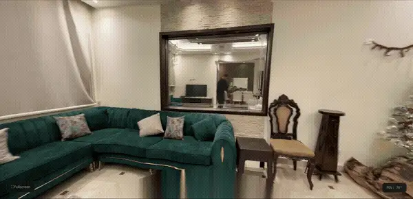

The v1 method, chaining and smoothing the pairwise rotations, is still there as `orientation.method: chain` ([TEMPORAL_SMOOTHING.md](TEMPORAL_SMOOTHING.md)). The full method, with the maths, is in [TECHNICAL.md](TECHNICAL.md).

## Quick start

```bash
git clone https://github.com/Kronbii/360-spherical-stitching.git
cd 360-spherical-stitching
pip install -r requirements.txt
```

Everything is driven by one YAML file. [config.yaml](config.yaml) is a working example; point `video` (or `input_dir` for a folder of stills) at your capture and set `output_dir`, then:

```bash
python run.py config.yaml
```

The run writes `panorama.jpg`, the extracted frames with their timestamps, the resolved `intrinsics.json`, the exact `config.json` it used, the orientations and their diagnostics (`orientation.json`, `orientation.npz`), the refined focal length as `intrinsics_refined.json`, and `viewer/index.html` to `output_dir`. Some browsers won't load the panorama over `file://`, so serve the folder:

```bash
cd <output_dir> && python -m http.server 8000   # then open localhost:8000/viewer/
```

**Calibrate the focal length once.** A sweep that comes back past its start pins the focal length; one that stops short can't, and its total angle is only as right as the configured focal length. Shoot one full turn with your phone, run it, and use that run's `intrinsics_refined.json` as `intrinsics.calib_json` for everything else from the same phone and video mode. [intrinsics.json](intrinsics.json) is that calibration for the phone used here.

Every option and its default is in [USAGE.md](USAGE.md). Tests:

```bash
python run_tests.py          # or: pytest -q
```

## Bundle adjustment on real footage

Two videos of the same room, no gyro: `IMG_1480.MOV` comes back to its start, the shorter clip above stops just short of it. Errors are pixel transfer errors on verified matches that bundle adjustment did not fit ([compare_orientation.py](scripts/compare_orientation.py)):

| Run | Focal | Sweep | Reprojection RMS | Where the loop meets |
|---|---:|---:|---:|---:|
| Full turn, v1 chain (trimmed at the closure) | 1475 px | 358.5° | 37.3 px | 323.7 px |
| Full turn, bundle adjusted (179 loop pairs) | 1669 px | 359.7° | 1.8 px | 1.9 px |
| Clip above, v1 chain (squeezed apart) | 1475 px | 317.8° | 36.9 px | – |
| Clip above, bundle adjusted | 1669 px | 323.6° | 1.9 px | – |

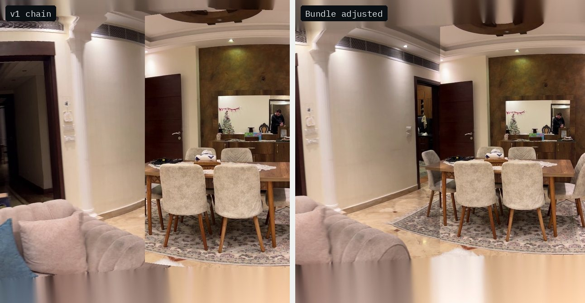

*Where the full turn meets its start. The v1 chain over-counts the turn by 12° and has to trim it; with the loop closed the wall, the door and the rug run straight through.*

The loop also measured the focal length: the 1475 px this repository used before was 11.6% short, since video stabilisation crops the frame. Run the clip with that wrong value and every pair still fits to 1.6 px, but the sweep reads 362.5° and has to be squeezed apart. That is why a full turn is worth shooting once per phone.

## With a gyroscope, in simulation

The gyro path is the same solve with the gyro as the prior. It has run only on **simulated data** so far: frames rendered from a known panorama as a camera turns 396°, and a 200 Hz gyro with bias, drift, scale error and noise, on its own clock and axes in the pipeline tests ([simulate.py](src/simulate.py), [run_sim.py](run_sim.py)). On a 73-frame sweep with the focal length starting 3.5% short, against ground truth:

| Orientation source | Mean rotation error | Last frame | Reprojection RMS |
|---|---:|---:|---:|
| Gyro only | 2.01° | 4.27° | 12.5 px |
| v1 chain | 0.50° | 0.66° | 5.4 px |
| Bundle adjusted, gyro prior | 0.022° | 0.018° | 0.98 px |
| Bundle adjusted, no gyro | 0.023° | 0.013° | 0.98 px |

Both bundle-adjusted runs recover the focal length that started 3.5% short to within 0.04%. On a clean simulated loop the two priors end up in the same place.

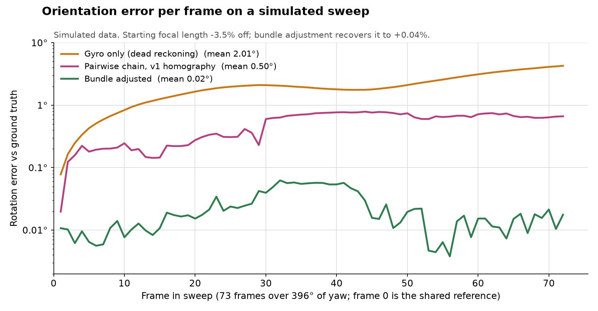

*Simulated: the gyro drifts to 4.3° by the last frame and the v1 chain ends 0.66° off; bundle adjustment with the gyro prior stays under 0.07° throughout.*

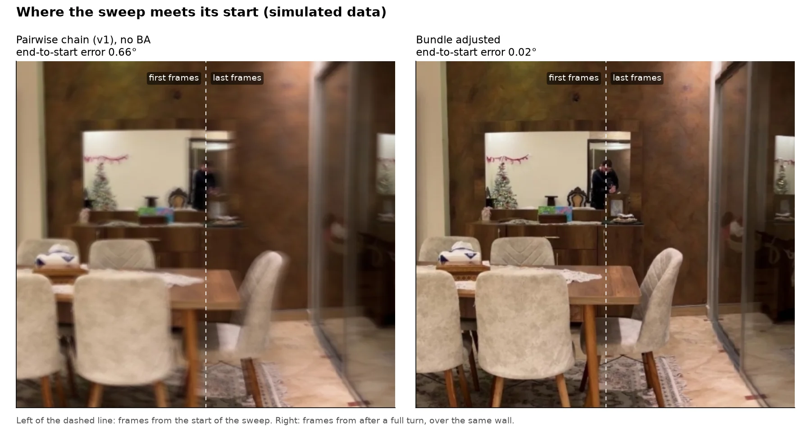

*Simulated: where the sweep meets its start, the v1 chain leaves a 0.66° break; after bundle adjustment it is 0.02°.*

[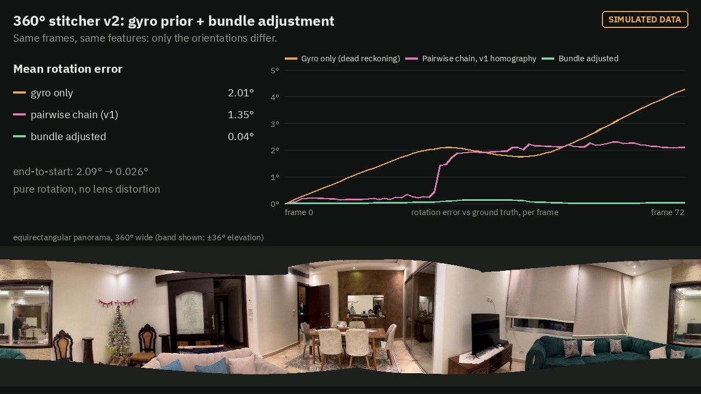](https://ramikronbi.com/projects/360-spherical-panorama-stitching)

*Simulated sweep, still frame. The animation is on the [project page](https://ramikronbi.com/projects/360-spherical-panorama-stitching).*

A real capture needs a gyro log next to the video, as CSV from any phone sensor-logger app; [USAGE.md](USAGE.md#gyroscope-optional) has the format.

## Repository layout

```
run.py              entry point: load the config, extract frames, run the pipeline
run_sim.py          both orientation priors on a simulated sweep, scored against ground truth
config.yaml         example configuration
intrinsics.json     focal length calibrated on a full turn, for the phone used here
src/                one module per stage; src/pipeline.py runs them in order
src/orientation.py  pair selection, focal search, rotation averaging, bundle adjustment
src/viewer/         the Three.js viewer template
scripts/            compare_orientation.py scores runs; make_v2_media.py draws the simulation figures
tests/              pytest suite (287 tests)
docs/               the demo site at 360.ramikronbi.com, and the README's images
showcase/           sample panorama and capture video
TECHNICAL.md        the method
TEMPORAL_SMOOTHING.md   how the v1 chain method smooths its rotations
USAGE.md            every config option
```

## Limits and what's next

- **Rotation only.** The camera is assumed to turn about its optical centre. Move it sideways past a nearby object and the scene no longer has a single rotation; that parallax, rolling shutter and stabilisation warps are most of the 1.8 px left.
- **A phone-height sweep doesn't cover a sphere.** One horizontal pass sees a band around you, 33.2% of the sphere on the sample run. The poles are filled, not captured.

  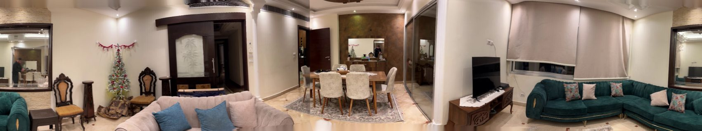

- **An open sweep can't measure the focal length.** Without frames that see the start again, the total angle is only as right as the configured focal length, and the ends are squeezed apart if they would overlap. Calibrate once on a full turn.
- **Texture drives the estimate.** Blank walls and repeating patterns give few usable matches. Where too few pairs match for a global solve, the run carries on with the prior and says so.
- **The gyro path is untested on real logs.** It estimates its own clock offset and axes, but no real phone log has been through it yet.
- **No exposure matching.** Brightness changes stay visible across seams.

## Links

- Live viewer: [360.ramikronbi.com](https://360.ramikronbi.com)
- Project page: [ramikronbi.com/projects/360-spherical-panorama-stitching](https://ramikronbi.com/projects/360-spherical-panorama-stitching)
- Write-up: [Building a 360° panorama stitcher from a phone sweep](https://ramikronbi.com/writing/building-a-360-panorama-stitcher-from-a-phone-sweep)
- Release notes: [2.0.0](https://github.com/Kronbii/360-spherical-stitching/releases/tag/2.0.0)

MIT License, see [LICENSE](LICENSE). Contributions are welcome, see [CONTRIBUTING.md](CONTRIBUTING.md).

Built by Rami Kronbi — [ramikronbi.com](https://ramikronbi.com)
