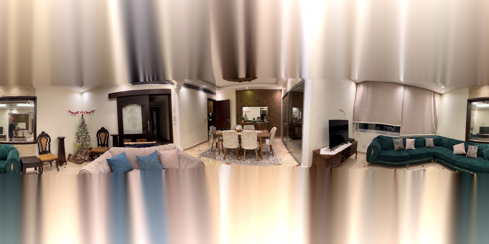
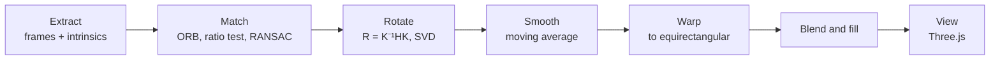
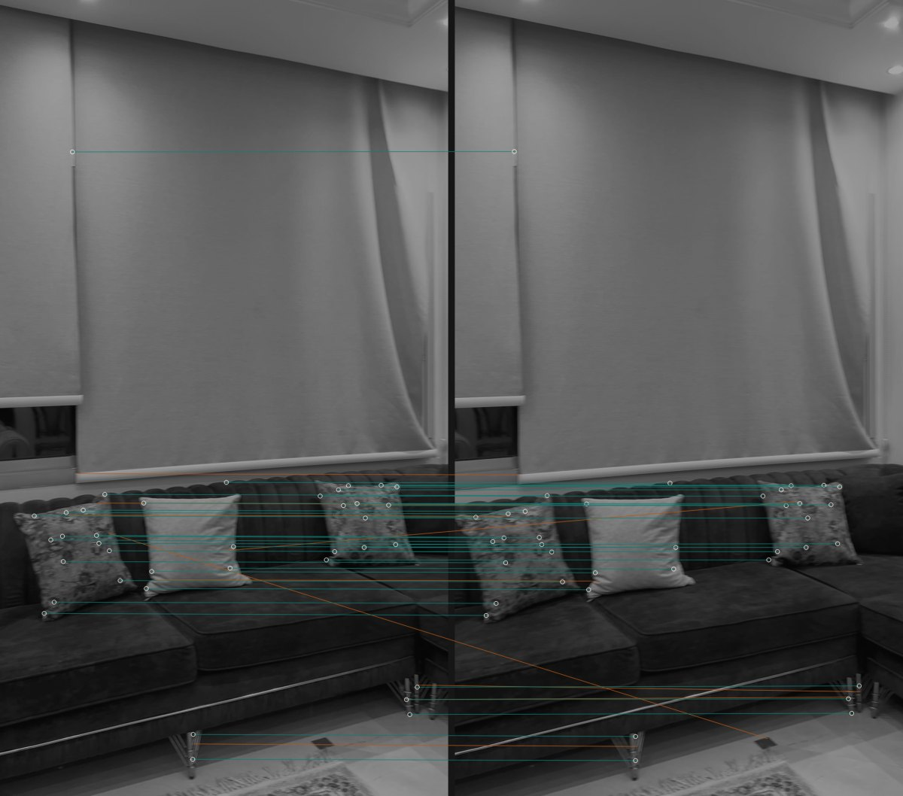
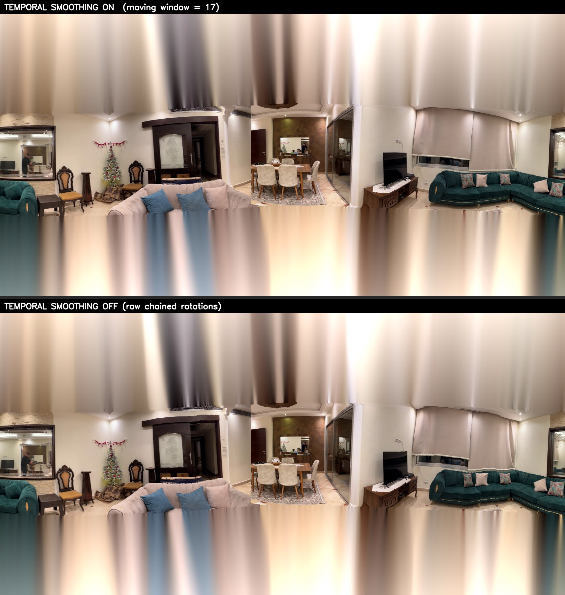
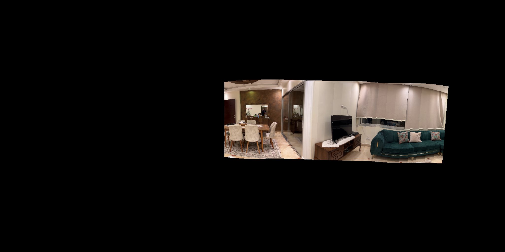
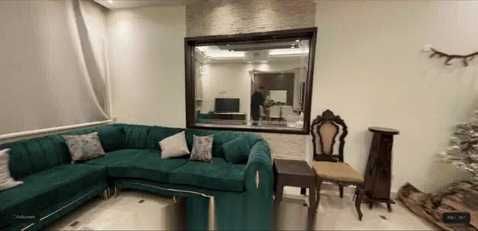
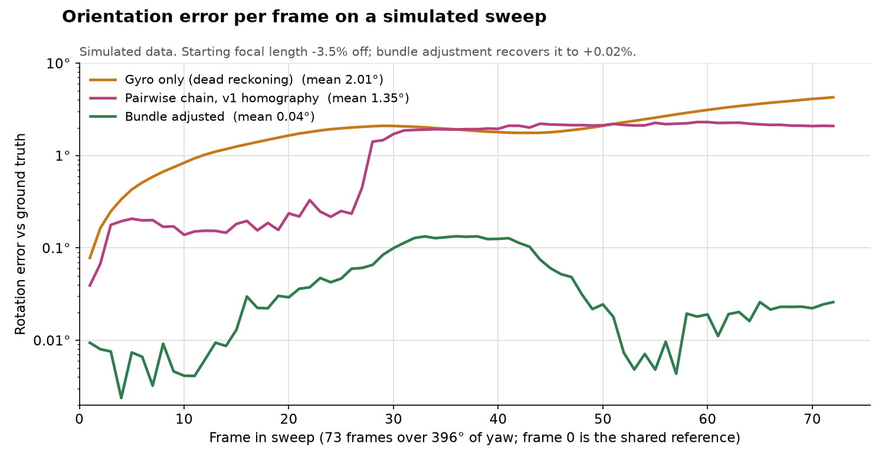
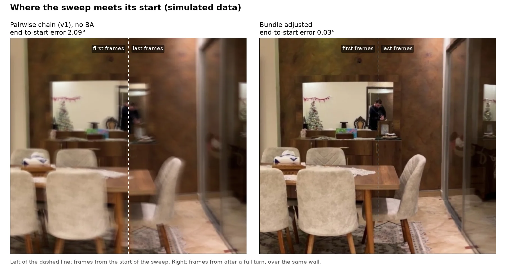
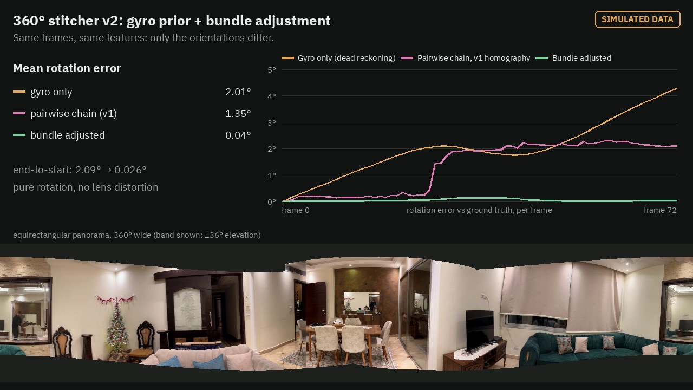
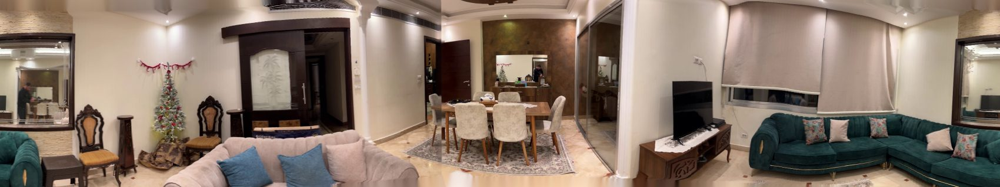

# 360° spherical panorama stitching

I built a CPU-only Python and OpenCV pipeline that turns a handheld phone sweep into an equirectangular 360° panorama, plus a browser viewer to look around in it. Every geometric decision is a module you can read, not a single "stitch" call.

[](requirements.txt)
[](requirements.txt)

**[Open the live viewer: 360.ramikronbi.com](https://360.ramikronbi.com)**



*309 frames of a phone video, one handheld sweep, 4096 × 2048 out.*

## Why

A panorama looks simple only after it works. Before that it is a chain of small geometric errors: a few bad matches tilt the camera estimate, a fraction of a degree of pitch turns a ceiling edge into a staircase, and a step sideways adds parallax that no homography can explain. General-purpose stitchers hide those decisions behind one call, which makes it hard to say why a panorama tilts, ghosts or drifts. I wanted each one out in the open. No gyroscope, no tripod, no stitching app: the geometry comes from image features and a pure-rotation camera model.

## One run

A 309-frame handheld sweep of a living room, every second frame of a phone video, matched at full resolution on a Ryzen 7 5800H, CPU only:

| | |
|---|---|
| Frames in | 309 |
| Recovered sweep | 333° |
| Median RANSAC inliers per pair | 921 |
| Pairs recovered by interpolation | 15 of 308 |
| Sphere actually imaged | 36.9% |
| Output | 4096 × 2048, equirectangular |
| End-to-end time | ~2 minutes (19 s matching, 96 s warping) |
| Smoothing | pitch wobble 13.5× lower, roll 5.2× lower |

## How it works



1. **Extract.** Frames come out of the video by interval, count, frame rate or measured motion ([video_utils.py](src/video_utils.py)). Focal length comes from EXIF when it's there, otherwise from a stated field of view or a calibration file ([intrinsics.py](src/intrinsics.py)).
2. **Match.** ORB features between neighbouring frames, Lowe's ratio test, then RANSAC. If a pair fails, the matcher tries across the gap and interpolates the missing step instead of silently dropping the frame ([features.py](src/features.py)).

   

3. **Rotate.** Under a pure-rotation model the relative rotation is `R = K⁻¹HK`. Noise means that matrix is rarely a true rotation, so SVD projects it back onto one before the rotations are chained into global orientations ([rotation.py](src/rotation.py)).
4. **Smooth.** Independent pairwise estimates leave a few tenths of a degree of pitch and roll error on every frame, enough to turn long straight edges into a staircase. A moving average over the chained rotations damps it. It is deliberately simple: not bundle adjustment, not loop closure ([TEMPORAL_SMOOTHING.md](TEMPORAL_SMOOTHING.md)).

   

5. **Warp.** Each output pixel is a world direction; rotate it into the camera, project it onto the image plane, sample ([warp_sphere.py](src/warp_sphere.py)).

   

6. **Blend and fill.** Overlaps are blended (`multiband`, `feather`, `sharp` or `none`) and whatever the sweep never saw is inpainted from its surroundings ([blend.py](src/blend.py)). Filling is not reconstruction.
7. **View.** A self-contained Three.js page is written next to the panorama.

   

The full method, with the maths, is in [TECHNICAL.md](TECHNICAL.md).

## Quick start

```bash
git clone https://github.com/Kronbii/360-spherical-stitching.git
cd 360-spherical-stitching
pip install -r requirements.txt
```

Everything is driven by one YAML file. [config.yaml](config.yaml) is a working example; point `video` (or `input_dir` for a folder of stills) at your capture and set `output_dir`, then:

```bash
python run.py config.yaml
```

The run prints a rotation summary as it goes and writes `panorama.jpg`, the extracted frames, the resolved `intrinsics.json`, the exact `config.json` it used, and `viewer/index.html` to `output_dir`. Some browsers won't load the panorama over `file://`, so serve the folder:

```bash
cd <output_dir> && python -m http.server 8000   # then open localhost:8000/viewer/
```

Every option and its default is in [USAGE.md](USAGE.md). Tests:

```bash
python run_tests.py          # or: pytest -q
```

## A second version: gyro prior and bundle adjustment

The first version has no bundle adjustment and no loop closure, so drift is damped rather than corrected. The second version, on the [`imu-bundle-adjustment`](https://github.com/Kronbii/360-spherical-stitching/tree/imu-bundle-adjustment) branch, adds both. A gyro, integrated between frames, predicts each camera's orientation. That prediction narrows where a feature can land in the next frame, so matching only searches a small window, and it says which frames a full turn apart should overlap, which is how loop closures are found without comparing every image with every other. Each pair is fitted with a rotation-only model, then bundle adjustment solves every orientation and one shared focal length together, with a robust loss, starting from the gyro.

So far it has only run on **simulated data**: frames rendered from a known panorama as a camera turns 396°, and a 200 Hz gyro with bias, drift and noise. On a simulated 73-frame sweep, against ground truth:

| Orientation source | Mean rotation error |
|---|---:|
| Gyro only | 2.01° |
| Pairwise chaining | 1.35° |
| Bundle adjusted | 0.04° |

Bundle adjustment also recovers a focal length that started 3.5% short to within 0.02%. Without the global solve the rotation-only chain is worse than the first version's, so the bundle adjustment is what earns the improvement.



*Simulated: the gyro drifts to 4.3° by the last frame and pairwise chaining ends 2.1° off; bundle adjustment stays under 0.14° throughout.*



*Simulated: where the sweep meets its start, chaining leaves a 2.09° break; after bundle adjustment it is 0.03°.*

[](https://ramikronbi.com/projects/360-spherical-panorama-stitching)

*Simulated sweep, still frame. The animation is on the [project page](https://ramikronbi.com/projects/360-spherical-panorama-stitching).*

The simulation leaves out lens distortion, rolling shutter, parallax and the camera-to-gyro time offset, and a real capture would need a synced sensor log. `run.py` on `main` still uses the first version.

## Repository layout

```
run.py              entry point: load the config, extract frames, run the pipeline
config.yaml         example configuration
src/                one module per stage; src/pipeline.py runs them in order
src/viewer/         the Three.js viewer template
tests/              pytest suite (186 tests)
docs/               the demo site at 360.ramikronbi.com
showcase/           sample panorama and capture video
TECHNICAL.md        the method
TEMPORAL_SMOOTHING.md   why and how the rotations are smoothed
USAGE.md            every config option
```

## Limits and what's next

- **Rotation only.** The camera is assumed to turn about its optical centre. Move it sideways past a nearby object and the scene no longer has a single homography.
- **A phone-height sweep doesn't cover a sphere.** One horizontal pass sees a band around you, 36.9% of the sphere on the sample run. The poles are filled, not captured.

  

- **Texture drives the estimate.** Blank walls and repeating patterns give few usable matches and can force interpolation.
- **No bundle adjustment or loop closure on `main`.** Drift is damped, not corrected. The second version adds both, but has only been validated in simulation.
- **No exposure matching.** Brightness changes stay visible across seams.
- **Known issues.** The smoothing window clamps at the ends of the sequence, so on a clip that finishes mid-motion the last frame can snap forward (5.4° on the sample run); reflecting the sequence at the edges would fix it. A few tests are stale: they pass `CalibrationData(source=...)`, a keyword the dataclass no longer takes.

## Links

- Live viewer: [360.ramikronbi.com](https://360.ramikronbi.com)
- Project page: [ramikronbi.com/projects/360-spherical-panorama-stitching](https://ramikronbi.com/projects/360-spherical-panorama-stitching)
- Write-up: [Building a 360° panorama stitcher from a phone sweep](https://ramikronbi.com/writing/building-a-360-panorama-stitcher-from-a-phone-sweep)
- Second version: [`imu-bundle-adjustment` branch](https://github.com/Kronbii/360-spherical-stitching/tree/imu-bundle-adjustment)

MIT License, see [LICENSE](LICENSE). Contributions are welcome, see [CONTRIBUTING.md](CONTRIBUTING.md).

Built by Rami Kronbi — [ramikronbi.com](https://ramikronbi.com)
