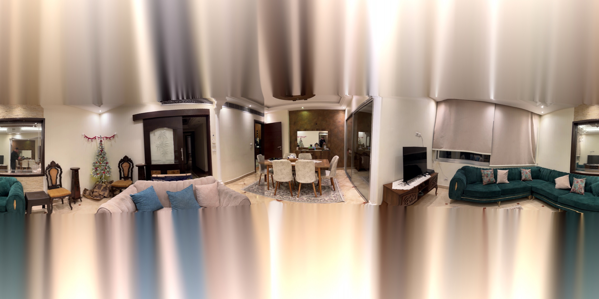

# 360° Spherical Panorama Stitching

Turns a handheld phone sweep into an equirectangular 360° panorama. The geometry
comes entirely from image features and a pure-rotation camera model — no gyroscope
data, no tripod, no stitching app.

**[Live demo](https://360.ramikronbi.com)** · [Usage guide](USAGE.md) · [Method](TECHNICAL.md) · [Smoothing notes](TEMPORAL_SMOOTHING.md)



## How it works

Give it a video or a folder of stills. Each stage below is a module in [src/](src/):

1. **Frames** — pulled from video at a fixed interval, uniform count, target fps, or
   by motion, then sorted by EXIF timestamp with a filename fallback
   ([video_utils.py](src/video_utils.py), [io_utils.py](src/io_utils.py)).
2. **Intrinsics** — focal length from EXIF where available, otherwise from a stated
   horizontal field of view or a calibration JSON ([intrinsics.py](src/intrinsics.py)).
3. **Matching** — ORB keypoints, Lowe's ratio test, then RANSAC for a homography per
   adjacent pair. If a pair fails, it retries across the gap at (i, i+2) and
   interpolates ([features.py](src/features.py)).
4. **Rotation** — each homography becomes a rotation, `R = K⁻¹HK`, orthonormalized by
   SVD so it stays a true rotation, then chained into global orientations. Pairs that
   never matched borrow from their neighbours ([rotation.py](src/rotation.py)).
5. **Smoothing** — an optional moving average over the chained rotations. It exists
   because independent per-pair estimates leave a few tenths of a degree of pitch and
   roll error on every frame, which shows up as a staircase along any long straight
   edge. On the sample run it cuts pitch wobble 13.5× and roll wobble 5.2×.
   Steps 4 and 5 are the v1 `chain` method; the default, `orientation.method: bundle`,
   replaces them with a global solve (see [Bundle adjustment](#bundle-adjustment-with-or-without-a-gyroscope)).
6. **Warp** — inverse-mapped to equirectangular: for each output pixel, take the world
   direction, rotate into each camera's frame, project, sample
   ([warp_sphere.py](src/warp_sphere.py)).
7. **Blend and fill** — `multiband`, `feather`, `sharp`, or `none` across the overlaps,
   then inpainting for whatever the sweep never saw ([blend.py](src/blend.py)).
8. **Viewer** — a self-contained Three.js page written next to the panorama.

## Install

```bash
git clone https://github.com/Kronbii/360-spherical-stitching.git
cd 360-spherical-stitching
pip install -r requirements.txt
```

Python 3.12, OpenCV, NumPy, Pillow, exifread, natsort. CPU only — there is no GPU path
and none is needed.

## Usage

Everything is driven by one YAML file:

```yaml
video: ./IMG_1480_2.MOV          # or: input_dir: ./photos
output_dir: ./output/livingroom

video_extraction:
  method: interval               # uniform · interval · fps · motion
  frame_interval: 2

matching:
  match_full_res: true
  min_inliers: 200
  rotation_smoothing_window: 17  # moving average over chained rotations

intrinsics:
  hfov_deg: 42                   # fallback when EXIF has no focal length

blending:
  method: none                   # multiband · feather · sharp · none

output:
  pano_width: 4096               # height is always width / 2
```

```bash
python run.py config.yaml
```

The run prints a rotation summary as it goes — recovered sweep, per-step angle, and any
pair whose homography looked suspicious. Output lands in `output_dir`:

```
output/livingroom/
├── panorama.jpg          # the equirectangular result
├── frames/               # extracted frames, when the input was video
├── intrinsics.json       # what the camera model resolved to
├── config.json           # the exact settings this run used
└── viewer/index.html     # drag-to-look viewer, open it in a browser
```

Some browsers refuse to load the panorama over `file://`. Serve it instead:

```bash
cd output/livingroom && python -m http.server 8000   # then open localhost:8000/viewer/
```

[USAGE.md](USAGE.md) documents every option and its default.

## What one run looks like

A 309-frame handheld sweep of a living room, every 2nd frame of a phone video, matched
at full 1080×1920 resolution on a Ryzen 7 5800H:

| | |
|---|---|
| Frames in | 309 |
| Recovered sweep | 333° |
| RANSAC inliers per pair | 921 median |
| Pairs recovered by interpolation | 15 of 308 |
| Sphere actually imaged | 36.9%, spanning +31° to −37° elevation |
| Output | 4096 × 2048 |

| Stage | Time |
|---|---|
| Feature matching, 308 pairs at full resolution | 19 s |
| Warping 309 frames to 4096 × 2048 | 96 s |
| Gap fill | 4 s |
| **Total** | **~2 min** |

The demo site walks through the same run stage by stage, including a real ORB match
visualization and a wipe comparison of smoothing on versus off:
**[360.ramikronbi.com](https://360.ramikronbi.com)**

## Bundle adjustment, with or without a gyroscope

`orientation.method: bundle`, the default, replaces the chained, smoothed rotations with
a global solve ([orientation.py](src/orientation.py)). It runs on any video; a gyroscope
log is optional. `method: chain` keeps the v1 path. If too few pairs match for a global
solve, the run carries on with the prior's orientations and says so.

1. **Prior** — a first guess at every frame's orientation. With a gyro log, the gyro
   integrated between frame timestamps ([imu.py](src/imu.py)); the clock offset and the
   gyro-to-camera axes are worked out from the video itself. Without one, the v1
   homography chain, unsmoothed, with the links it could not measure marked as doubtful.
2. **Pair selection** — every frame against its next three, one pair about half a field
   of view away, and the frames the sweep comes back to after going round: the loop
   closures chaining never sees.
3. **Guided matching** — ORB matches searched near where the prior predicts each keypoint
   lands (falling back to the whole frame when the prior is off), then a rotation-only
   model fitted by two-point RANSAC on bearing vectors ([guided_match.py](src/guided_match.py)).
4. **Rotation averaging** — every frame's rotation made consistent with every pair at
   once, dropping pairs that still disagree by more than 3°. This spreads the loop's
   accumulated error over the whole sweep before any pixel is measured.
5. **Bundle adjustment** — all rotations and one shared focal length refined against the
   pixels of every pair, with a soft-L1 loss and an analytic Jacobian
   ([bundle_adjust.py](src/bundle_adjust.py)).
6. **Warp and blend** — unchanged, with the refined focal length. When loop-closure pairs
   matched, the ends are aligned rather than squeezed apart.

```yaml
orientation:
  method: bundle
imu:                       # optional
  gyro_csv: ./gyro.csv
```

[USAGE.md](USAGE.md#orientation) lists every option. A bundle run also writes
`orientation.json`, `orientation.npz` and `intrinsics_refined.json`.

### On real footage

Two phone videos of the same room, without a gyro: `IMG_1480.MOV`, which comes back to
its start, and the shorter demo clip `IMG_1480_2.MOV`, which stops just short of it.
Errors are pixel transfer errors on verified correspondences that bundle adjustment did
not fit ([compare_orientation.py](scripts/compare_orientation.py)):

| Run                                                   |   Focal |  Sweep |     RMS | Loop pairs |
| ----------------------------------------------------- | ------: | -----: | ------: | ---------: |
| Full sweep, v1 chain (trimmed at the closure)         | 1475 px | 358.5° | 37.3 px |   323.7 px |
| Full sweep, bundle adjusted (179 loop pairs)          | 1669 px | 359.7° |  1.8 px |     1.9 px |
| Demo clip, v1 chain (squeezed apart)                  | 1475 px | 317.8° | 36.9 px |          – |
| Demo clip, bundle adjusted, configured focal (squeezed) | 1475 px | 317.8° | 35.8 px |        – |
| Demo clip, bundle adjusted, focal from the full sweep | 1669 px | 323.6° |  1.9 px |          – |

On the full sweep the loop-closure pairs pin everything down, the focal length included:
the configured 1475 px was 11.6% short (video stabilisation crops the frame). The demo
clip has no loop, so its total angle depends on the focal length: with the wrong one,
every pair still fits but the sweep reads 362.5° and has to be squeezed apart, as v1
does. Started from the full sweep's `intrinsics_refined.json` it reads 323.6°, which is
what the frames show. So calibrate once on a capture that comes back round, and reuse
that focal length for the same phone and video mode.

Each run takes about three minutes for ~300 full-resolution frames and stays under
1.8 GB of memory.

### In simulation, against ground truth

The simulator ([simulate.py](src/simulate.py)) renders pinhole frames from an existing
equirectangular image for a camera turning about its centre, and a 200 Hz gyro with
bias, bias random walk, scale error and noise. Ground truth is exact, so each stage can
be scored:

```bash
python run_sim.py --world showcase/panorama.jpg --out output/sim
python scripts/make_v2_media.py --sim output/sim     # figures and a short video
```

On the default run (73 frames, 396° of yaw, starting focal length 3.5% short):

| Orientation source              | Mean error | Last frame | Reprojection RMS |
| ------------------------------- | ---------: | ---------: | ---------------: |
| Gyro only                       |      2.01° |      4.27° |          12.5 px |
| Pairwise chain, v1 homography   |      0.50° |      0.66° |           5.4 px |
| Pairwise chain, v2 rotation     |      6.13° |     12.21° |          62.4 px |
| Bundle adjusted, gyro prior     |     0.024° |     0.018° |          0.98 px |
| Bundle adjusted, no gyro        |     0.022° |     0.010° |          0.98 px |

Both bundle-adjusted runs recover the focal length to within 0.04%. The rotation-only
chain is the most sensitive to a wrong focal length; the global solve is what removes
that sensitivity.

Not simulated: parallax from camera translation, lens distortion, rolling shutter, motion
blur, camera–gyro misalignment beyond an axis permutation. The gyro path has not yet run
on a real gyro log.

## Assumptions and limits

- **Rotation only.** The camera is assumed to turn about its optical centre. Translate
  while sweeping and nearby objects will not line up — that is parallax, and a
  homography cannot represent it.
- **A phone-height sweep does not cover a sphere.** One horizontal pass images roughly a
  third of it; the rest is inpainted from its surroundings and will look smeared. Tilt up
  and down across several passes if you want real pole coverage.
- **Texture drives the estimate.** Blank walls, blown highlights, and repeating patterns
  produce few usable inliers. The pipeline carries on by borrowing a neighbour's rotation
  rather than dropping the frame.
- **The v1 `chain` method accumulates error.** The default `bundle` method spreads it
  around the loop instead. Neither method matches exposure between frames.
- **A sweep that stops short of the start cannot be closed.** Without frames that see
  the start again, the images do not pin the focal length, so the total angle is only as
  right as the configured one, and the ends are squeezed apart if they would overlap.
  Calibrate the focal length once on a sweep that does come back round.

## Tests

```bash
python run_tests.py          # or: pytest -q
```

Nearly 300 tests cover config, IO, intrinsics, feature matching, rotation, blending,
warping, and the bundle-adjustment path end to end on rendered sweeps, with and without a
gyro log.

## Repository layout

```
run.py            entry point: load config, extract frames, run the pipeline
run_sim.py        both orientation methods on a simulated sweep, scored against ground truth
scripts/          media for the simulation; compare_orientation.py scores real runs
src/pipeline.py   the eight stages, in order, with logging
src/              one module per stage (see "How it works")
tests/            pytest suite
docs/             the demo site (deployed on Vercel)
showcase/         sample panorama and capture video
```

## License

MIT — see [LICENSE](LICENSE). Contributions welcome; see
[CONTRIBUTING.md](CONTRIBUTING.md).
